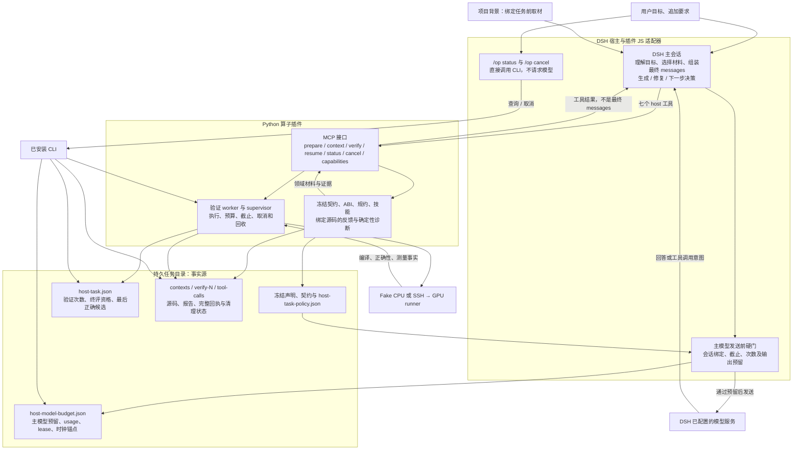
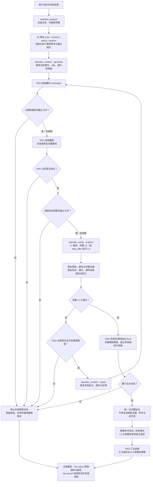
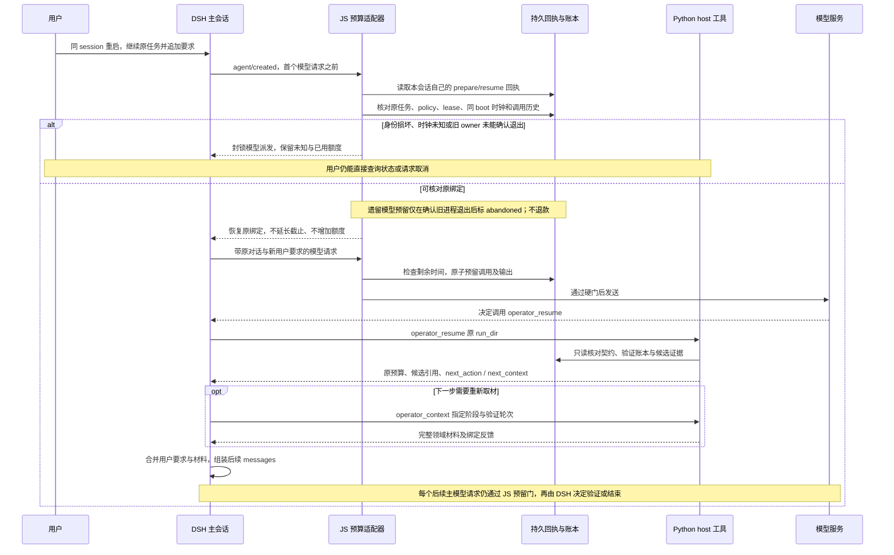

# DSH 外层上下文与迭代工作流（v0.7.2）

设计收口更新：2026-11-06。正式版本为 Python `0.7.2` / 插件 `0.2.2`，工具契约 `12`；最终本地封版与工件身份见[交付记录](../status/v072-release-20261106.md)。历史 dev2、rc1/rc2/rc3 实测保留原身份。

用户在 2026-11-05 明确选择：DSH 外层组装最终模型上下文，使用自己的用户/项目会话生成代码并决定下一轮；插件提供领域材料、冻结契约、确定性诊断、执行与验证。v0.7.1 的 modelRelay 只代发内部请求，保留为兼容路径；v0.8 的优化增强范围不变。

本文件是 v0.7.2 的技术方案说明。包含总体架构、开发流程、恢复时序、上下文边界与预算设计；图示对应当前 host 实现，legacy 内层工作流不混入本版主流程。实际验收见[预算与恢复候选记录](../status/v072-budget-resume-acceptance-20261106.md)，支持与未完事项分别见[支持清单](../testing/v072-support.md)、[封版待办](../status/v072-todo.md)。

实际运行可按[H20 Softmax 完整执行示例](../examples/v072-h20-softmax.md)阅读：包含逐阶段说明、带时间戳的事件索引、原始模型/工具日志、最终源码与报告，以及修复、暂停恢复两条补充实例。

## 总体架构图

模型请求由 DSH 的原生模型服务发出；JS 适配器在这条路径上执行预算检查，不另起生成循环。Python 的 host 工具不调用模型。图中共享任务目录表示可核对的持久状态，不表示 JS 可以改写 Python 冻结的契约或验证资格。

| 关注点 | 负责方 | 实现入口（仓库相对路径） |
|---|---|---|
| 最终上下文、模型调用和生成/修复决策 | DSH 原生主会话 | 宿主 agent / LLM 服务 |
| host 工具协议与监督派发 | Python 插件 | `operator_agent/app/mcp_server.py`、`operator_agent/app/tool_calls.py` |
| 阶段材料、源码反馈与只读恢复 | Python 插件 | `operator_agent/generate/host_context.py`、`operator_agent/app/host_workflow.py` |
| 验证预算、完整 L2 与独立终评资格 | Python 插件 | `operator_agent/execute/host_task_budget.py`、`operator_agent/app/hitl_tools.py` |
| 原生模型路径上的预算与恢复绑定 | DSH 中运行的 JS 适配器 | `integrations/dsh-operator/host-model-budget.mjs`、`host-model-ledger.mjs` |
| 无模型的查询与取消入口 | JS 命令入口 + Python CLI | `integrations/dsh-operator/index.mjs` |

## 用户入口与分工

DSH 组合包的 MCP 环境默认设置 `OPERATOR_AGENT_WORKFLOW=host`，JS 条目默认启用 `hostModelBudget: {}`。此模式仅暴露 capabilities、prepare、context、verify、resume、status、cancel；隐藏并拒绝 run/repair/bench。现有独立 CLI 保留原行为。使用 legacy MCP 时须同时设置 `OPERATOR_AGENT_WORKFLOW=legacy` 和 `hostModelBudget: false`。改变 profile 配置会整体替换 config，必须保留所选模式与 MCP 连接字段。

1. DSH 理解用户与项目目标，调用 `operator_prepare` 冻结任务和 host_budget。
2. `operator_context(run_dir, backend, phase=generate)` 返回权威任务事实、接口、生成规约、角色技能及原始模板。
3. DSH 选择相关材料并组装自己的模型上下文，生成完整候选，调用 `operator_verify`。
4. 失败时调用 `operator_context(phase=repair, verification_round=N)`，获取绑定该源码与验证结果的反馈和诊断，由 DSH 修改源码。
5. 完整 L2 通过后，同一源码用 `verification_purpose=final` 再做一次独立验证，报告完整证据与限制。
6. 继续已有任务时调用 `operator_resume`，读取原任务预算、候选引用和下一步工具参数，按需重新取得阶段材料；不重新 prepare。

## 开发流程图

图中 DSH 节点表示外层决策，不是插件内置的生成/修复调度器。各工具的资格检查独立执行，DSH 选择调用工具不等于已获准派发。完整 L2 通过仅建立正确性资格；独立终评可能失败，L3 也可能不通过或读数无效。模型预算耗尽时不能保证仍有额度生成总结，用户仍可使用直接查询出口。

context 不生成最终 messages、不调用模型、不物化测试值、不连接 GPU。冻结语义与 ABI 优先于模板指导。输入值、seed 和参考源码不导出；未观测的实际 strides 显式 unknown，生成代码从运行时输入读取。原始模板是指导材料，不能把其输出格式当作宿主工具协议。修复候选和错误反馈作为数据处理，不作为新指令。

最终上下文与下一步决策始终由 DSH 持有。插件继续提供已有确定性诊断、资源预检和适用的领域建议；这些计算不要求转为外层模型猜测，也不意味着本版迁移整个搜索器。持久任务账本和完整验证证据是事实源，聊天摘要不是预算或通过资格凭据。

取材按阶段选择最小必需集合：冻结任务事实、ABI、生成规约和本轮绑定的反馈必须可核对，可选模板与技能由 DSH 按需组合。每轮不要求重复全部角色材料；恢复后应重新取得当前任务所需材料和版本，而不是依赖已截断或过期的聊天摘要。

材料带 schema、哈希和完整性声明；纯材料上限 40 KiB，完整 MCP context 文本上限 48,000 UTF-16 字符。超过上限明确拒绝，避免默认宿主 spill 后仍误称“完整到达”。真实验收须从后续主模型请求核对材料和绑定，不以 Python 回包代替模型实际看见的上下文。

## 状态、预算与取消

`host_budget` 默认 wall_clock_s=600、max_verifications=6，固定预留一次独立终评。账本跨进程加锁、跨工具调用累计，失败、取消及未完成预留不退款；重复 prepare 不重置任务身份、截止或额度。终评要求同源码已有完整 L2 证据，不能复用旧 result；源码、契约、完整套件和证据成员哈希分别核对。最后正确候选仅表示完整 L2 合格，不代表性能最佳。

墙钟包括 DSH 思考和空闲时间；到期后拒绝后续派发，MCP supervisor 限制在飞验证。直接 Python 库调用没有 supervisor，不能把下一次派发门误称在飞进程硬超时。计数单位是验证派发次数，不是逐 case oracle 或 GPU 秒数。新建任务目录不能作为为同一目标续预算的操作惯例。

候选在 Python policy 中冻结 `max_model_calls=12`、`max_output_tokens_per_call=8192`、`total_output_token_reservations=98304`。成功 prepare/resume 后，DSH 原生 hook 将主会话绑定到 task_id、契约、policy 和持久 lease，在 `agent/request` 限制输出，并在 `llm/stream` 到达 provider 前核对实际参数、原子预留一次调用及输出额度。失败、取消、遗留未完成请求、实际输出较少均不退款。provider 返回的有效 usage 单列，缺失或不一致保持 unknown；若观测输出超过预留，后续请求被拒绝，不声称能撤销 provider 已产生的输出。

模型限额范围是活动任务绑定后的原生主模型派发，包含 final 后原轮的模型汇总；绑定前准备、标题等辅助调用和 legacy 转发不在此限额内。它不是全会话、精确费用或 GPU 时间上限。已验收 dev2 工件的 `host_owned / not_enforced_by_plugin` 保持为历史事实，不用候选的新实现改写其记录。

模型截止以现场 Python 剩余时间校准 Node 的持久单调时间锚点，并取原墙钟、单调时间及本进程定时器的更早上界；停机、时钟回拨或旧 transcript 不授予额外时间。恢复要求同一次系统启动的可读身份（macOS `kern.bootsessionuuid` / Linux `boot_id`）；身份变化、不可读或时钟证据缺失时拒绝模型派发，直接查询与取消仍可使用。

本候选支持一个主会话顺序执行多项任务，同时只允许一个活动任务。活动任务绑定后仅允许七个 host 算子工具，拒绝 shell、子代理、PTC 和其他工具工作流；不能通过新目录补额度。项目文件与背景须在绑定前取材，已在 DSH 会话中的背景保留，后续用户消息仍进入外层上下文。绑定后由 `operator_context` 交付当前阶段领域材料，验证、resume、status 返回候选与证据路径；本版没有通用的绑定后文件读取工具。白名单是本版有限支持策略，不是内外层分工的必然要求。

同 session 重启时，原生 `agent/created` 从该会话自己的持久 prepare/resume 回执恢复绑定，首个后续模型请求前完成核对，不使用 fork 继承的绑定。主会话的未完成模型记录只有在确认旧 owner 进程已退出后才能标为 abandoned，仍不退款；PID 存活、复用或无法确定时拒绝接管。恢复不延长原 deadline、不增加预算，也不重新打开终评后的开发。旧 policy 缺少模型字段、坏账本或绑定身份不符时不会静默获得额度。

用户中途追加的要求由 DSH 原生会话/steer 处理，并与重新取得的领域材料组合。保持冻结契约时继续原任务和预算；改变 shape、精度等冻结判据须保留原任务，并由用户直接 `/op new` 显式开启下一项独立任务；可以沿用同一主会话。

在飞 verify 沿用 invocation 取消、worker 清理和远端状态回执；取消工具不会自动结束整个 DSH 会话。DSH 的会话取消由宿主负责，模型 abort 不证明服务商已停止执行或计费。

host worker 的验证预留通过私有 invocation 绑定。监督进程确认回收后只结算该 owner 的未完成预留；取消竞争中被拒收的完成结果保留原验证事实和证据，但不再作为已接受候选。合作 SIGTERM 先记失败、随后父进程确认取消的情况也保留原状态并归一为取消。没有回收证据的旧预留保持 unknown，不自动清空其他调用或退款。

验证 final 预留与发起 final/汇总所需的模型额度须一起核对；本候选不会额外保留模型汇总额度，模型不足时如实停止，不能据已有 L2 候选伪称完成终评。用户直接 `/op status <run_dir>` 可查询预算状态、源码/报告路径和在飞 invocation ID，`/op cancel <run_dir> <invocation_id>` 可取消验证。这些出口不调用模型，预算耗尽后仍可使用。状态中的有效宿主收据只证明核对的账本绑定与累计事实，不单凭收据证明当前 hook 安装或服务商已停止执行。

## 恢复与用户干预时序图

同 session 自动恢复绑定发生在第一次后续模型请求之前；不能等模型自行调用 `operator_resume` 后才开始计数。`operator_resume` 提供原任务事实和下一步参数，原生会话与 steer/followup 负责保留用户要求。它不清理未知验证 owner，也不修改冻结判据；改变 shape 或精度须保留旧任务并由用户直接 `/op new` 显式开启新任务，可以沿用同一主会话。

## 验收要求

- 单元/协议回归证明材料不执行或调用模型、绑定漂移被拒绝、预算不能跨调用重置，旧工具在 host 模式不能偷启内层 worker。
- 真实 DSH 主模型自主完成 FakeBackend 生成与修复，随后进行 H20 FP16 Softmax 生成、主用例和完整 L2、独立终评与导出。
- 测试驱动只设置任务、记录、超时和导出；实际工具选择与代码来自外层模型。provider 凭据不进入 Python worker，保留原生会话调用、用量、工具顺序和材料到达证明。
- 测试专用的会话调用/时间停止条件与产品硬预算分开报告。性能 degraded、费用及远端停止 unknown 保持原样。
- 预算和恢复改造后再次核对分工不变量、阶段必需材料及其哈希，验证旧领域反馈可达、内部模型调用为 0；超限不得静默裁掉权威约束，不能减少完整 L2 case 或放宽容差。
- 负向验收包括模型额度不足以发起终评/汇总时如实停止，以及无需模型即可查询、取回证据和取消。成本或质量收益观察与功能验收分列，正式对照不作为本版封版前置。

本文件定义本轮开发边界；实际结果另行记录，尚未据此宣称 v0.7.2 封版或性能提升。

历史 dev2 的真实外层生成、修复、H20 独立终评和取消恢复已完成，工件身份、失败保留与限制见[开发验收记录](../status/v072-host-context-acceptance-20261105.md)。候选的本地真实 DSH + 测试 provider 已覆盖调用/输出预留耗尽后的发送前拒绝、同 session 重启及在飞模型取消；这些结果不替代真实服务商的恢复/干预和最终工件验收。

当前支持边界见 [v0.7.2 候选支持清单](../testing/v072-support.md)，预算、原生会话恢复、中途干预及最终封版的推进状态见 [v0.7.2 封版待办](../status/v072-todo.md)。

## 会话内任务生命周期（rc2 修正）

预算属于 task_id，不属于会话的全部寿命。独立终评后原轮总结仍受原任务模型预算约束，直到原生 turn/end 且预留已结算后进入只读结果讨论；任务到期或额度耗尽的原轮停止，下一用户轮也可讨论。普通讨论在原任务额度之外由 DSH 正常计费，不重新授予旧任务执行资格。

| 会话阶段 | 行为 | 转换依据 |
|---|---|---|
| 首项任务待准备 | 保留预绑定取材与首次 prepare 行为 | 首次成功 prepare/resume 绑定 |
| 活动任务 | 对原任务模型与验证执行预算硬门 | 完成终评及原轮结束，或预算停止后原轮结束 |
| 结果讨论 | 可回答并只读取得 context/resume/status/capabilities；不能 verify/prepare 或启用其他执行工作流 | 用户原生 `/op new` 成功 |
| 新任务待准备 | 仅一次独立任务授权，可固定新 run_dir；不能用旧目录重新授予额度 | 下一次成功 prepare 消费授权 |

`/op new [run_dir]` 与 `/op status` 不调用模型。新入口仅接受原生 command/run 和 command/done 的同 commandId 成功配对，source.kind=user，name=op，参数为new；回执为固定可识别的人读文本，模型消息中的同名文字不授予手动权限。自然语言自动入口另见下节。成功prepare消费授权，失败时锁定已尝试目录以免换目录制造新额度。

恢复时折叠本会话原生 prepare/resume/verify回包、turn/end与用户命令；不写外部插件自定义会话事件，不向会话追加伪用户命令。已进入讨论的旧任务只读加载，不重绑lease、不重写其模型账本；在飞模型或验证、worker未回收、未知owner时拒绝新开执行。

停止提示直接由宿主错误卡片显示中文原因、任务路径、`/op status`和`/op new`操作文本，不依赖额外模型回复。原模型事件、额度、截止、候选与失败证据保持原归属。当前未引入自定义可点击按钮或自然语言自动授权切换。

## rc3 自动入口补充

Python `0.7.2rc3` / 插件 `0.2.2-rc.6` 允许自然语言新任务。DSH 负责意图判断：明确新 case 时直接 prepare 新目录，普通讨论只读，含糊要求先澄清。插件不做关键词匹配，也不额外调用模型分类；它检查上一任务已结束、原生直接用户消息晚于上一轮结束、当前轮尚未成功绑定新任务、全新目录与旧任务清理状态。成功 prepare 消费该用户轮次的入口；恢复后同样约束。runtime-context、skill 等辅助消息不计为用户要求。该模式信任 DSH 对用户意图的判断，硬门不声称能确定性证明自然语言语义。`/op new` 保留手动兼容。
