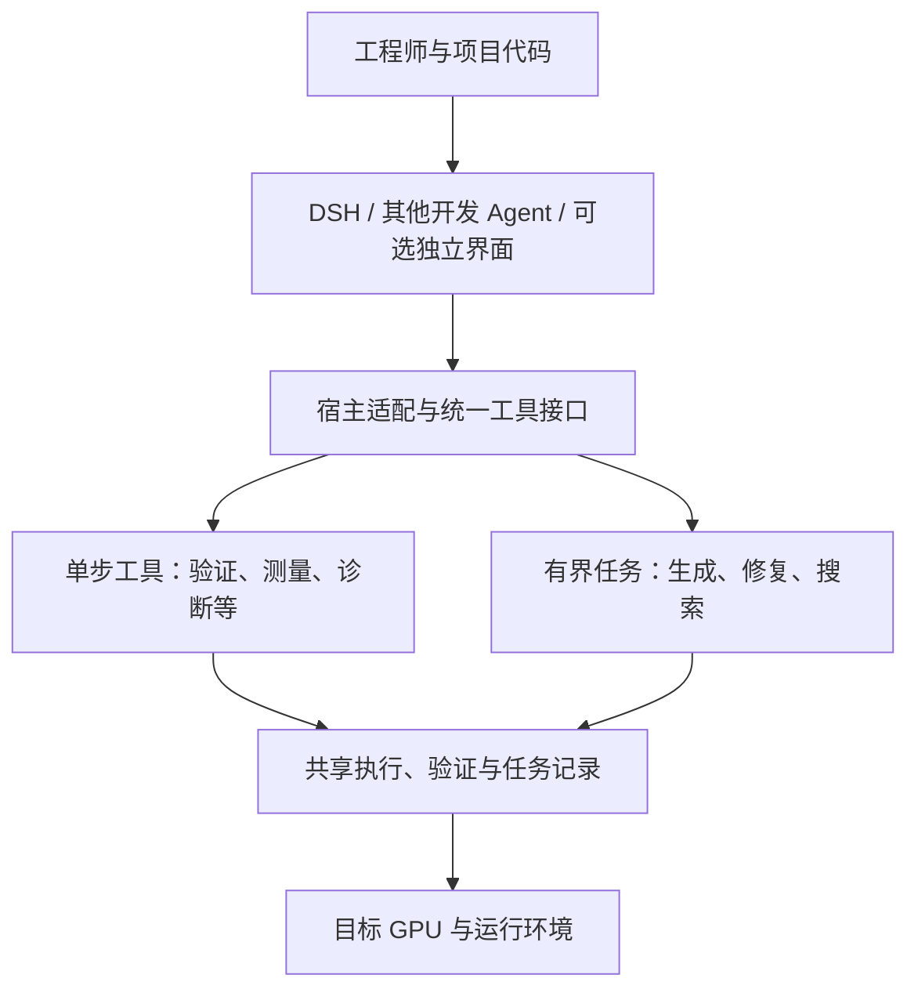

# 算子开发助手：产品价值、架构与可用版本迭代路线

| 项目 | 说明 |
|---|---|
| 文档性质 | 以可用版本为单位的产品路线与架构取舍；未来版本均为计划 |
| 文档修订 | v0.6（不同于下文的产品发布版本） |
| 创建 / 最近更新 | 2026-10-30 / 2026-11-02 |
| 来源 | 本轮关于用户价值、招聘与一线需求、独立 Agent 与插件形式的讨论 |
| 核心方向 | DSH 作为首个产品入口，核心能力保持宿主无关，以真实用户收益决定后续扩展 |

本文回答“为谁解决什么问题、采用什么形态、用什么证据决定下一步”。接口、不变量和判定规则仍以[设计规范](autonomous-operator-agent-design.md)为准；实现与验收事实通过状态文档引用。本文不代替既有技术路线，也不将后续工作记为已启动或已完成。

## 1. 核心价值与产品定位

帮助工程师用更少的人力、时间和试错成本，交付在真实业务中满足正确性、性能与接入要求的算子。

近期产品主张：**缩短从现有算子到可验收优化结果的时间。**

“开发更快”和“算子运行更快”分别衡量，任一项稳定成立，都可以形成用户价值：

| 价值 | 用户获得什么 | 主要衡量方式 |
|---|---|---|
| 开发提效 | 更快获得正确实现或完成既有实现的优化 | 首次正确时间、达到验收目标的总时间、人工实际投入 |
| 运行性能提升 | 在给定硬件和业务输入上改善延迟、吞吐或显存占用 | 同预算下的最终性能、各必判输入的回退情况 |
| 降低返工 | 尽早发现精度、边界输入、测量或接入问题 | 缺陷发现阶段、返工时间、交付后的回归问题 |
| 适配与维护提效 | 更快迁移到新硬件、框架或输入分布 | 迁移时间、性能回归定位时间、重复工作的减少 |
| 团队经验复用 | 复用经过验证的策略、配置和失败经验 | 独立新任务上的成功率、耗时和成本变化 |

验证、报告、候选留存、恢复和经验库是支撑能力。其产品收益要落实为省下的时间、减少的返工、改善的性能或维护成本；工具数、报告数和生成代码量不作为主要成功指标。

“可交付”需要区分验收层次：

- **正确候选**：完成约定输入范围与精度标准的正确性验证。
- **性能达标候选**：在正确性成立后，完成约定性能目标与回退约束的有效确认。
- **业务交付结果**：完成目标框架或模型接入，并通过约定的端到端检查。

仅完成前一层时，报告按该层描述，不能将 kernel 测试通过直接等同于业务交付。

## 2. 用户与需求依据

### 2.1 首批目标用户

优先服务**已有参考实现或候选代码、正在目标硬件上做算子优化的工程师**。其任务应具备可明确描述的输入范围、精度要求、目标硬件、参考实现和预算。

这类任务便于建立前后对照，也能利用现有验证、测量和修复能力。该优先级是产品假设，需通过试用确认。

后续用户方向包括从零开发算子的工程师、模型训练与推理性能工程师、异构硬件适配人员，以及维护算子库的团队。具体扩展顺序由任务频率、问题成本和实际使用结果决定。

### 2.2 招聘样本提供的需求信号

以下是 2026-10-30 本轮检索的公开岗位样本，说明相关能力被雇主明确要求；它们不构成整个市场的岗位数量、增长率、薪资或工具付费意愿统计。页面后续可能下线或变更，复用时需重新核对。

| 来源 | 岗位要求的能力 | 对产品方向的启示 |
|---|---|---|
| [智元：算子开发工程师](https://agirobot.jobs.feishu.cn/campusrecruitment/position/7672290308671441171/detail) | Attention、融合与量化算子优化，GPU/NPU 适配，框架接入，测试与 benchmark | 工作范围覆盖实现、调优、适配和交付 |
| [深圳大数据研究院：算子工程师](https://www.sribd.cn/recruitment/1438) | 异构硬件高性能实现、端到端分析、模型部署与成果产品化；页面标注截止日期为 2026-12-31 | 需把单算子优化与实际模型、硬件和集成联系起来 |
| [Anthropic：Performance Engineer](https://job-boards.greenhouse.io/anthropic/jobs/4020350008) | 低精度推理 kernel、服务效率、系统性能建模 | 算子能力需要服务于训练或推理的系统目标 |
| [Anthropic：Performance Engineer, Inference Systems](https://job-boards.greenhouse.io/anthropic/jobs/5224564008) | 跨层性能定位、正确性评估、吞吐与延迟分析，按收益和投入排序机会 | 定位值得优化的问题、量化收益和检查数值回归同样重要 |

### 2.3 公开工程实践提供的需求信号

| 来源 | 公开实践 | 对产品方向的启示 |
|---|---|---|
| [PyTorch：KernelAgent 硬件指导优化，2026-03-06](https://pytorch.org/blog/kernelagent-hardware-guided-gpu-kernel-optimization-via-multi-agent-orchestration/) | 采集 Nsight Compute 硬件指标，诊断瓶颈并迭代优化 | 可重点缩短“读性能数据—提出假设—安排实验—判断结果”的过程 |
| [Meta 团队：GDPA 生产训练优化，2026-03-18](https://pytorch.org/blog/generalized-dot-product-attention-tackling-real-world-challenges-in-gpu-training-kernels/) | 真实流量中的变长、非规则输入与合成 benchmark 存在表现差异，需按生产负载重新设计 | 评价必须覆盖真实输入分布与模型收益 |
| [NVIDIA：CUDA 工具链优化实践，2026-09-02](https://developer.nvidia.com/blog/the-modern-cuda-toolbox-in-practice-a-step-by-step-optimization-walkthrough/) | 串联错误检查、性能剖析、库原语选择、内存管理与流水线优化 | 复用已有工具并组织有效流程，可以成为助手的价值来源 |

上述材料属于公开的一线实践，并非本项目已完成的用户访谈。由其推导的产品需求，仍须在实际用户工作中验证。

### 2.4 首轮用户调研

建议起点是与 3–5 位目标工程师复盘最近完成或卡住的真实任务；样本用于发现问题和选择试点，不用于推断市场总体比例。

重点收集：任务与验收标准、当前使用的工具和 AI 助手、各环节人工投入与等待时间、反复失败的原因、最终接入情况，以及哪些环节愿意委托自动执行。

历史任务的「各环节人工投入」一项未记录，保持未知（核查记录见[阶段 A 台账 §3.1](../phase1/stage-a-ledger-20261031.md)）。**2026-11-01 修订：一期不要求人工执行对照或逐格填表，也不以人工记录完整度为阶段门槛。** 两臂均由 Agent 执行，从有来源的会话与执行日志自动记录可观测人工介入；无法观测的阅读、思考和活跃分钟数仍为未知，不能用等待时长或调用次数冒充。自报仅在已有信息时作为可选补充，不为评估新增填报工作。

尽量用现有任务、代码和实验记录还原流程。试用后同时记录实际省时、额外配置或纠错成本，以及用户是否愿意在下一项任务中继续使用。

## 3. 产品形式与架构取舍

### 3.1 两个维度分别决策

**入口形式**决定用户在哪里使用：DSH、其他开发 Agent，或独立应用。

**执行方式**决定优化过程由谁控制：宿主逐步调用工具，或将一段明确目标和预算内的任务委托给后端。

二者可以组合。独立运行的优化流程可以通过插件调用；跨宿主工具也可以包含有状态的专业执行流程。

| 形式 | 主要优势 | 主要成本 | 采用条件 |
|---|---|---|---|
| DSH + 插件 | 复用现有会话与开发环境，便于结合项目代码使用 | 需要维护宿主适配，效果也受宿主行为影响 | 作为首个成熟入口验证真实用户收益 |
| 其他 Agent + 共用工具 | 用户保留熟悉的环境，核心能力可跨宿主复用 | 工具调用、权限、文件访问和展示方式存在差异 | 核心工作流与收益稳定后，验证第二个宿主 |
| 独立 Agent 应用 | 可完整设计实验管理、任务与交互体验 | 需自行维护通用会话、代码编辑、模型接入和产品设施 | 用户持续需要宿主难以承载的专门工作台 |

近期保持 DSH 入口，持续复用已有后端。是否建设独立应用，由专门交互与运营需求决定。后台长任务本身可以由任务后端承载，不单独构成建设完整应用的充分理由。

### 3.2 目标分工



图中包含长期目标能力，具体落地范围以实现状态和入口验收为准。

| 层次 | 主要责任 |
|---|---|
| 宿主 Agent | 理解业务目标、阅读项目、沟通方案、选择任务范围与投入，解释结果 |
| 适配层 | 安装与发现、参数与文件传递、调用与取消、进度和结果展示 |
| 专业工具与任务后端 | 编译执行、测试、测量、性能剖析、有状态修复或搜索、候选与实验留存 |
| 验证与测量程序 | 按冻结标准产生正确性、性能及测量有效性事实 |

任务记录、候选身份、预算和可恢复状态应独立于聊天记录保存。跨宿主接管必须核对任务身份和已有执行状态；接入同一协议本身不代表恢复与取消语义已经兼容。

### 3.3 协作与委托两种使用方式

- **协作开发**：用户与宿主逐步分析、修改和验证；每次工具调用完成明确动作后返回控制权。
- **委托执行**：宿主给出目标、范围和预算，由后端自主完成一段优化；宿主查询进度、请求取消或读取终稿。

同一段执行过程只由一方控制搜索和预算。委托期间宿主需要更改目标时，应按既有契约和取消语义处理，避免两套循环同时修改同一任务。

### 3.4 内层模型与领域知识

专门的生成器、修复器或搜索流程是否扩大使用，依据同预算的成功率、达标时间、运行性能和状态管理收益决定。

领域知识和生成规约应具备可复用接口。“某份知识只注入内层”不能单独证明内层更优。对照不同生成方式时，要明确模型、可见上下文、工具、采样与预算差异。

现有 `operator_run`、`operator_repair` 继续按既有契约使用。单候选生成、独立性能剖析等新接口属于候选演进项，需分别设计与验收；本文不把它们当成现有工具，也不重开既有暂停实验决定。

## 4. 演进起点与现有文档的关系

当前能力和证据通过以下入口核对，本文不复制历史实现状态或替代验收报告：

| 阅读目的 | 事实与规则来源 |
|---|---|
| 了解八个工具和具体入口 | [插件 README](../../integrations/dsh-operator/README.md)、[插件实现说明](dsh-plugin-implementation.md) |
| 了解内外层分工、共享生成上下文与证据限制 | [分工边界](hitl-generation-boundary.md)、[方案评审](operator-development-review-20261026.md)、[共享生成上下文](shared-generation-context.md) |
| 核对插件整体价值是否已经建立 | [S5 结项记录](../status/dsh-operator-s5-closeout-20261030.md)、[性能 A/C 记录](../status/dsh-operator-s5-kernel-performance-results-20261030.md) |
| 核对安装与交付范围 | [S6 交付验收](../status/dsh-operator-s6-acceptance-20261030.md) |
| 查看技术不变量与工程优化顺序 | [设计规范](autonomous-operator-agent-design.md)、[技术优化路线](autonomous-operator-agent-optimization-directions.md) |
| 核对 v0.7 交付范围与对照准备顺序 | [一期执行清单](../phase1/operator-development-phase1-execution-20261031.md)、[阶段 A 台账与基线](../phase1/stage-a-ledger-20261031.md) |
| 评估异步、事件与任务恢复方案 | [事件驱动与持久任务架构提案](dsh-operator-event-driven-architecture.md)；属于候选技术路线，启用条件见本文 §5.5 与 §7.1 |

工具链可运行、单个候选比 PyTorch 快、插件优于同条件开发基线，分别需要不同证据。已有 core/CLI 成绩不能直接归因于 DSH 插件；单次配对也不能外推为稳定的整体增益。

**从本次修订起，以可安装、可完成完整任务的产品版本安排迭代。** 原阶段 A–F 保留为历史证据分类：A/B 的需求与工作流验证并入首版及各版验收，C 对应优化增强，D 对应业务接入，E/F 对应后续复用与规模化；不逐个换名当作六次发布。原 Stage、Wave、S0–S6 和一期 W1–W3 编号继续解释历史任务，不作为产品发布版本。

## 5. 可用版本迭代路线

**每版交付一条用户能独立用完的工作流，并继承前版已承诺的能力。** 需求研究、基线、试跑和架构准备属于版本内工作，不单独算一个可用版本。下表是计划，不预设发布日期，也不表示这些版本已经实现或发布。

| 目标产品版本 | 用户拿到这一版能做什么 | 本版新增交付 | 发版验收 |
|---|---|---|---|
| **v0.7 基础可用版（当前一期目标）** | 在明确支持的硬件与算子范围内，提交参考实现/候选、输入与预算，委托 Agent 生成或修复，取得可复核的源码、正确性与性能结论 | 首个 DSH 插件完整入口、安装包与示例；任务准备、执行、状态/取消、独立终评与结果导出；自动归档机器指标和可观测介入事件 | 干净环境安装后从入口完成至少一条真实任务的全流程，支持清单内约定任务通过验收回归；失败/未知、预算和清理事实可核。两臂自动对照结果完整披露，不能把一次达标或 +1 当稳定优势 |
| **v0.8 优化增强版** | 在 v0.7 完整流程中查看瓶颈依据、比较候选，并在预算内自动迭代优化 | 为已支持算子补齐最有价值的性能采集/诊断、多候选比较或搜索；输出诊断→实验→选择的证据链 | 在事先冻结的独立任务与同预算对照中，新增能力达到约定的达标数、耗时或性能改善；原有生成、修复与终评仍可用，退化可回退 |
| **v0.9 业务接入版** | 将已验证候选实际用进一个明确的框架或模型，运行端到端检查和接入回归 | 一个受支持框架/模型的接入路径、可执行示例、输入分布与端到端基线、持续回归命令和回退开关；可由 Agent 协助接入，不强制全自动改业务代码 | 至少一个真实接入在约定输入上通过正确性/质量及性能回退约束，端到端表现实测，回归与切回参考实现可复现；不由 kernel 加速比外推 |
| **v1.0 稳定版** | 在公布的支持范围内，将前述开发、优化、接入与回归流程持续用于日常任务，并按说明升级或回退 | 固定兼容矩阵、稳定接口与任务格式、升级/迁移说明、可复现交付包；异常恢复、预算与清理语义的正式验收 | 声明的接口/环境通过兼容与故障场景验收，升级及回退演练成功，既有任务回归通过；稳定承诺限于支持清单，不等于所有算子或硬件都支持 |
| **v1.1 团队复用版** | 将完整任务包交给另一位开发者或第二宿主继续查询/执行，复用经独立验证的经验 | 第二宿主适配、任务交接包、共享范围与权限、经验准入/过期/撤销机制；保留单人本地工作流 | 两个宿主完成同一任务与交接验收，不重复执行、不分叉验证或计量语义；独立新任务验证经验复用收益，权限与撤销生效 |
| **v1.2 批量运行版** | 提交一批已支持任务，在明确资源与总预算下排队运行、观察结果并取消或恢复任务 | 批量入口、资源队列、并发/配额、汇总结果与预算控制；多硬件调度或独立工作台仅按已验证需求增补 | 约定真实负载下完成整批终态对账、预算与隔离验收；单任务流程不退化，规模增大后的资源和维护代价可报告 |

目标版本号接续当前 Python 工件 `0.6.x`，用于规划发布里程碑；**本次不修改包版本、不发布工件**。实际发版时记录产品版本对应的 wheel、插件包各自版本、内容哈希和协议身份，插件壳不要求与 wheel 同号。文档修订号、实验计划 `phase1-agent-comparison-v2` 与产品版本分别维护。`v1.2` 之后按需求继续迭代，不视为路线终点。

v0.7 可用性与“优于普通 Agent”的收益主张分别验收：功能可用、结果如实且边界明确可以形成有限支持的版本；对照无收益则限制主张、收缩新增投入，不能伪造增益。v0.8 的“优化增强”必须有增量证据。每版都能停留使用，不要求用户等待 v1.0 才拿到完整流程。后续版本只冻结近期一版的细化范围，实际任务可推动业务接入或最小宿主适配提前验证；不自动扩大一期范围。

### 5.1 v0.7 的最小完整工作流

输入：参考实现、候选代码、业务输入范围、目标硬件、精度与性能目标、执行预算。

过程：准备任务 → 检查与运行 → 分析反馈 → 修改或修复 → 比较候选 → 最终验收。

输出：最终源码、适用输入与环境、测试结果、性能结论、总投入及未解决问题；按任务约定提供接入说明或端到端结果。

优先围绕少量真实算子族做完整流程。任务台账用于选择支持范围；未经验收的算子、dtype、布局或硬件标明实验性或不支持，不用静默默认补齐。v0.7 的可用出口至少包括安装 → 声明任务 → 执行 → 查询/取消 → 独立终评 → 读取源码与报告；用户无需逐格执行实验或填表。没有性能改善时也必须给出可复核结论与原因。

v0.7 同时提供 [FakeBackend 离线组件检查](../testing/fake-backend.md)：日常用 fake 后端与脚本模型检查流程，显式选择真实模型检查模型接线，租卡后再验收编译、GPU 正确性与性能。fake 结果一律标记 test_only，不补作真机成绩或跨臂对照；该实现已落地于源码树，工件交付仍按一期清单验收。

自动采集 Nsight 指标、给出性能瓶颈诊断和自动接入框架等能力，应明确区分已有实现和后续版本工作；L3 延迟或 Roofline 数字本身不代表已完成完整的性能剖析。

### 5.2 功能投入的判断规则

| 功能方向 | 优先推进的证据 | 调整方向的信号 |
|---|---|---|
| 新诊断规则 | 用户反复卡在该问题，诊断能改善修复率或耗时 | 只是增加解释，结果和投入没有改善 |
| 多候选生成 | 新增正确或达标结果足以覆盖额外成本 | 调用显著增加，收益未复现 |
| 自动性能搜索 | 相同预算下更容易达标，或得到更好候选 | 反复选择起点、收益不稳定，或验证成本占满预算 |
| 新硬件后端 | 有明确迁移任务和可维护的测试基线 | 缺少真实任务、资源或后续维护条件 |
| 第二宿主 | 首入口收益成立，且用户存在其他宿主需求；有明确试点任务时可先做最小适配 | 主要精力转向重复适配，核心收益尚不清楚 |
| 独立应用 | 实验比较、团队协作或批量管理持续受入口限制 | 主要工作变为维护通用会话与编辑功能 |

### 5.3 v0.9 的业务交付与回归验收

业务接入验收可以由工程师手动集成、插件协助完成；是否建设自动接入功能，依据实际投入与收益另行决定。新增状态机阶段或自动修改业务代码不作为验收前提。

出口条件包括：

- 至少完成一个明确版本的真实框架或模型接入，保留实际调用路径和可重复的运行方式；仅提供接入说明不足以通过。
- 约定输入范围与分布，包括相关 shape、dtype、布局及边界情况，检查正确性、模型质量和单形状之外的性能回退。
- 分别报告 kernel 性能、端到端表现和开发投入；端到端结果包含调用、数据转换及实际接入开销，不能由 kernel 加速比外推。
- 保存硬件、驱动、编译器、框架、候选与契约身份，以及输入版本；建立可重复执行的接入回归，约定哪些环境或代码变化需要复核。
- 提供回退到已验证实现的路径并检查其可用性；回归失败时保留失败与未知结果，不自动放宽精度或性能目标。

以开发提效为主要价值时，端到端目标可以是预先约定的性能和质量不回退；不要求每项任务都提升模型吞吐，但必须实际验证其接入结果。

### 5.4 继续、转向与停止条件

每个版本开始实施前冻结一份交付与验证计划：用户可完成的完整工作流、继承能力、新增范围、支持清单、基线、主要评价问题、功能及收益门槛、重复方式、停止规则，以及本轮最多投入的工程时间、任务数、模型调用、验证与机器资源。预算单位分别保留；无法执行的预算约束要明确说明，不能把调用上限写成 GPU 时间硬上限。

| 版本 | 继续投入的证据 | 转向或收缩的信号 | 停止该方向的条件 |
|---|---|---|---|
| v0.7 | 支持清单内完整流程可用，问题基线与自动对照可复核 | 收益集中在局部环节，或配置纠错抵消改善 | 预算内连有限支持的完整流程也无法交付，则停止扩大范围；对照无增益不宣称优势 |
| v0.8 | 新诊断或搜索在独立任务上有约定的增量收益 | 生成、测量或调度成为主要瓶颈 | 新增能力无可复核收益则不以“优化增强”验收，保留前版工作流 |
| v0.9 | 真实接入达到目标，回归与回退可重复执行 | kernel 改善未传递到业务，调整任务或接入方式 | 预算内仍无法满足质量、性能或交付效率目标，停止该接入扩展 |
| v1.0 | 兼容矩阵、升级与异常场景均可复核 | 支持范围过宽，缩小稳定承诺 | 升级破坏已有任务或故障语义不可核则不标稳定，继续提供前版 |
| v1.1 | 第二宿主/团队交接与经验复用产生实际价值 | 只需最小适配，或经验跨环境不适用 | 缺少需求或维护投入超过收益，停止该宿主或共享功能扩展 |
| v1.2 | 真实批量负载可完成且总投入可接受 | 收益只在特定负载成立，收窄调度范围 | 预算、隔离或终态对账不可靠则不扩大并发，保留单任务与前版能力 |

这里的停止针对具体场景、功能或扩展投入，不自动等同于停止整个项目。预算耗尽或设施中断时先停止本轮执行，按预定规则报告失败或未知；不得为通过门槛临时追加预算、改目标或删除任务。需要新一轮验证时，说明新依据并使用新的计划与身份。

### 5.5 近期范围与技术提案的启用顺序

**一期归属 v0.7 基础可用版，v0.7.0 按有限支持范围本地交付。** 安装、宿主入口、独立终评和取消见[交付记录](../testing/v07-delivery.md#11-v070-本地封版)。原 W1 身份收口、W2 任务基线和 W3 执行准备属于这个版本。正式 A/B 可比性、性能资格和历史人时按各自证据记录，八格接入试跑见[一期执行清单 §5.2](../phase1/operator-development-phase1-execution-20261031.md)与 [runbook §0](../phase1/stage-b-runbook-20261101.md)。

[事件驱动与持久任务架构提案](dsh-operator-event-driven-architecture.md)提供控制面候选方案。其 P0-A/P0-B 优先级是提案内部排序，不自动成为一期执行优先级，也不因本文引用而进入实施范围。

长调用阻塞、任务失联或恢复问题实际妨碍试点时，可以先设计并验证解决该阻塞的最小改造，保留原有同步、取消、预算与证据语义。统一事件协议、完整 Watchdog、多 Worker、性能剖析、多宿主和独立应用分别按需求与验收条件推进，不打包为一期的新增前置条件。

### 5.6 每个版本共同的可用交付条件

- **可取得、可安装**：版本对应明确的安装包、依赖/环境与支持清单；干净环境按说明安装验证。本地交付包也可以构成版本，公开发布另按既定授权执行。
- **可独立用完**：从任务输入到结果有一条完整入口，交付可运行示例、最终源码/接入产物及可读报告；不能把一组内部脚本或待开发模块当成可用版。
- **边界与结果可信**：明确支持和实验范围，预算可核，失败、未知、取消及远端清理如实报告；用户无需替自动流程补跑或填表。
- **前版能力延续**：对前版支持任务执行必要回归；新增功能可禁用或回退，破坏性接口/数据变化有迁移说明，不能为了新增能力令原工作流失效。
- **可核对、可回退**：保留产品版本→各包版本→源码/协议/evaluator/候选哈希的清单、验收记录、已知问题及回退方式；发布范围与收益主张分别说明。

各版实施清单必须分别列功能完成、安装回归、收益验证和发布状态。研究完成、测试通过或版本号已写入都不能单独勾选“已交付可用版本”。

## 6. 如何证明用户收益

### 6.1 两种主要评价问题

1. **固定验收目标**：在同等任务条件下，是否更快达标、减少人工投入和总成本？
2. **固定开发预算**：预算结束时，是否有更多达标任务，或得到更好的最终性能？

每轮先选主要问题，再明确验收门槛、重复方式和停止规则。收益门槛由用户任务价值与测量能力共同决定；本路线不把历史实验目标直接设为所有任务的统一标准。

### 6.2 公平对照

- 开发基线采用固定的 Agent 与常用脚本，保持正常的验证和执行能力，由 Agent 自主执行；插件臂同样由 Agent 执行，不要求用户手工开发。冻结实际入口、工具与脚本身份；入口尚未确认时如实记待冻结，不冒称实际用户工作流。
- 控制模型、硬件、任务输入、起始代码、参考实现与预算上限；必要差异在计划中说明。
- 将插件发现、工具调用成功与否、用户绕过工具、额外配置和纠错成本纳入记录。
- 评估最终源码对应的结果，最终确认所需时间和费用计入总投入。
- 使用未参与规则开发的任务检查泛化；比较新增功能时，尽量通过消融对照识别该功能的额外收益。
- 全部已派发任务均保留，分别报告成功、失败与未知；预登记但未执行的任务另列，避免只统计成功样本。

### 6.3 指标与口径

| 指标 | 口径要求 |
|---|---|
| 达标任务数 / 率 | 验收条件预先约定；分母和失败、未知单列 |
| 首次正确时间 | 达到完整正确性标准的时间；未达到者保留停止原因与耗时 |
| 验收总时间 | 从约定任务起点到终评完成；接入验收是否包含在内需明确 |
| 人工介入观测 / 实际投入 | 从有来源的用户纠正、外部编辑或接管回执自动提取事件，保留 actor、环节、动作、明确原因及来源覆盖；Agent 行为不算人工，缺来源保持 unknown。只报观测到的事件数，不能据此推断活跃时间；自报量级档可选、不要求补填。人时与机器秒分列，不以填表完整度阻塞一期，也不宣称一期证明节省人时 |
| 最终运行性能 | 约定输入分布上的延迟、吞吐、显存及回退约束；说明性能基线与测量有效性 |
| 开发资源投入 | 分开记录模型消耗、验证次数、墙钟、可测 GPU 时间和实际费用；缺失保持未知 |
| 业务收益 | 完成集成后，按约定报告模型或服务吞吐、延迟、质量和资源成本 |
| 持续使用 | 用户是否在后续真实任务继续使用，以及放弃原因 |

成功任务的平均耗时应与成功率一起报告；不能通过放弃难任务制造“更快”的结论。模型调用预留、验证 case 次数、GPU 时间和实际账单金额保持不同计量单位。

### 6.4 总投入与单位经济性

从 v0.7 开始比较基线与插件流程在同一任务或观察期内的可观测总投入，v1.2 进一步验证批量负载下的可持续性；人工与账单未知时明确限制总体结论。

需要分别收集模型调用与实际费用、机器资源、接入与配置纠错、可观测人工介入，以及后续维护投入。一期优先自动采集可核验的机器指标与事件，不新增用户填表任务；已有人工自报量级保持原口径，缺失的账单或人工投入记为未知，不按零计算，也不强行折算为精确金额。接管事件减少不等于节省人时，不能独立证明整体成本更低。

评价的问题是：可核验的人工与机器成本节省，加上已验证的业务收益，能否覆盖新增开发、运行、接入和维护成本。明确比较基线、观察期、业务负载和摊销假设，避免重复计入同一份资源节省或业务收益。

能够可靠货币化的部分可以比较净收益；其他收益与成本分别报告，必要时使用有依据的区间并说明结论对假设的依赖。成本或收益未知时，仍可报告已测维度的改善，但不能据此声称整体成本更低或规模化经济性已经成立。

### 6.5 控制面收益单独评价

异步、事件与 Watchdog 的主要指标是交互阻塞时间、主动查询与人工恢复负担、重复执行数、异常发现与对账时间，以及新增资源与维护成本。单独记录任务结束、本机清理、远端清理和服务商请求的事实。

不能单纯以降低 `lost/unknown` 比率为成功条件：正确识别更多未知也可能是改进。应检查是否减少漏报、误报、重复执行和无效等待；缺少证据时继续保留未知。编排收益不直接证明生成质量或 kernel 性能提升。

## 7. 跨版本长期轨道

四条轨道伴随版本迭代，各版只建设其工作流与自主范围所需的能力。已有可用机制优先复用，具体落地状态仍由独立验收记录说明。

### 7.1 控制面与可恢复性

| 产品版本或触发条件 | 建设与验收重点 |
|---|---|
| v0.7：完整任务闭环 | 状态可查询、取消语义明确、实例与内容身份可核对；异常不能冒充验证结果，本机退出与远端停止分别报告 |
| v0.8 或更早出现的实际阻塞 | 按阻塞情况引入可选异步、事件续读与确定性 Watchdog；先只读对账，再验证有界恢复，保持同步兼容 |
| v1.0：稳定运行 | 验收重启、恢复与升级路径，明确无法恢复时的终态和回退，继续核对执行所有权与剩余预算 |
| v1.1：第二宿主 | 重启后重查任务、事件去重、迟到结果与取消竞争行为通过一致性验收 |
| v1.2：批量运行 | 按真实负载扩展资源队列、多 Worker、订阅与调度；计量排队、执行、恢复和额外消耗 |

Watchdog 不经过模型改判，不自行改候选、契约或提示词。只有能核对执行所有权、远端状态和剩余预算时才执行预定义恢复动作；无法核实是否仍在运行时，不自动重启造成重复执行。具体方案参见[事件驱动提案](dsh-operator-event-driven-architecture.md)，DSH 推送等宿主能力须经实际验证后使用。

### 7.2 协议与证据可迁移性

v1.1 形成宿主一致性验收包，至少覆盖：

- 相同任务语义、TaskSchema、冻结契约、候选内容与验证证据身份；协议版本及能力差异明确。
- 启动、状态查询、取消、恢复，以及已实现事件接口的续读与去重语义；无推送能力时通过约定的查询方式取得相同事实。
- 宿主或 MCP 重启、迟到事件、启动重试和取消完成竞争，不导致重复执行或终态被旧结果覆盖。
- 验证、计量、报告和权限范围不因宿主分叉；不同展示形式不改变事实含义。
- 同一任务包可交接到另一宿主，核对数据可达性、访问权限、身份与已有所有者后继续查询或接管，避免重新解释任务或盲目重跑。

不要求不同宿主具有相同界面或私有 API。任务包能被读取也不代表已经具备执行、接管或取消权限。

### 7.3 安全与自主等级

自主等级描述允许委托的范围，区别于产品版本。现有授权继续有效，扩大自动执行范围前先定义触发源、动作、权限和预算，并验证其边界。

| 等级 | 执行方式 | 扩大使用前的验收重点 |
|---|---|---|
| 协作执行 | 人或宿主逐步发起工具，完成动作后返回控制权 | 工具输入、执行范围、候选验证和结果身份明确 |
| 有界委托 | 冻结目标、预算和允许范围后后台执行 | 单一执行所有者、状态与取消、预算及证据留存可核对 |
| 事件驱动主动执行 | 对预先允许的事件执行限定动作 | 事件来源与触发准入、去重、防重复执行、凭据隔离、资源预算和动作审计通过验证 |

事件数据不能直接变成任意代码或命令执行入口，触发事件不能扩大既有授权。控制面更自主不扩大验证器的通过标准，也不意味着候选已处于完整沙箱。候选执行隔离按实际威胁模型单独建设与验收；长期轨道不改变一期已经确定的交付范围。

### 7.4 团队知识生命周期

长期知识复用按以下顺序建设：

```text
run-local 经验 → 独立任务验证 → 按硬件 / 工具链 / 契约分区
              → 满足既有准入规则后共享 → 过期、撤销与回归复核
```

经验绑定来源、候选与验证身份、适用条件和有效性证据。正样本与失败经验分开解释；诊断假设不直接升级为已验证规则。硬件、工具链或契约变化后重新核对适用性，错误经验可撤销，不能因被检索到就继续用于新的晋级决策。

共享前明确接收范围与代码使用权限，排除凭据、私有连接信息和不应外传的源码或路径元数据。此轨道不改变现有入库准入、独立确认及 HITL 路径的既定边界。

## 8. 架构决策与重新评估条件

| 当前方向 | 依据 | 何时重新评估 |
|---|---|---|
| DSH 为首个产品入口 | 可利用现有接线验证真实工作流 | 入口限制已成为主要使用障碍，或首批用户集中使用其他环境 |
| 核心能力保持宿主无关 | 复用验证、执行和任务记录，支持后续扩展 | 某宿主能力确有独特收益时，在适配层明确差异 |
| 保留单步工具与有界任务 | 同时支持工程师参与和委托执行 | 实际使用表明某种模式维护成本高、使用价值低 |
| 内层模型按实测收益扩大使用 | 专用生成与搜索应有可检验的增量收益 | 模型或宿主能力变化后，重做同条件对照 |
| 业务交付先于大规模复制 | 接入与回归验证用户最终需要的结果；可在早期做小规模试点 | 试点用户需要其他宿主时先最小适配，保留业务验收要求 |
| 事件驱动按实际阻塞启用 | 优先复用实例、状态、取消与持久记录，单独评价控制面收益 | 长调用、恢复或多任务问题阻碍试点时，验证最小必要改造 |
| 独立应用按需求建设 | 专门界面与团队功能应服务实际使用 | 持续需求和使用规模证明其必要性 |
| 按真实工作负载评价 | 输入分布、硬件与框架接入会影响收益 | 业务或环境变化时刷新任务与基线 |

这些方向属于本轮讨论形成的路线建议。影响既有控制权、工具契约或判定语义的调整，仍需在对应设计中明确后再实施。

## 9. 长期维护方式

每完成一轮用户试用、正式对照或重要入口变更，更新相应证据与下一步判断。职责保持分离：

- 本文维护价值定位、目标用户、版本交付顺序和架构选择。
- 实现状态与验收报告维护具体能力、版本、测试和执行结果。
- 研究记录维护访谈摘要、公开资料核查、实验过程及被推翻的假设。
- 技术设计维护接口、不变量和判定规则。

每次路线复盘回答：用户最耗时的环节是否变化；新增复杂度是否产生额外收益；真实接入与回归是否成立；当前入口是否限制使用；本轮预算是否支持继续、转向或停止；下一步最值得验证的一个问题是什么。

公开招聘与工程资料在继续用于产品决策时重新核对。已下线页面保留原引用与核查日期；更新后的判断说明依据，避免将早期样本当成持续成立的市场统计。

### 路线修订记录

| 日期 | 变更 | 依据 |
|---|---|---|
| 2026-10-30 | 创建 v0.1：以交付效率为近期主张，DSH 为首入口，专业后端独立复用，按用户收益推进阶段 A–E | 本轮讨论、公开岗位与工程实践、现有设计和验收资料 |
| 2026-10-31 | v0.2：**阶段 A 的出口条件改写**。原句「能明确指出谁在什么环节花费时间」要求按环节的人工分钟数；一期 W2 查证结果为——历史运行没记过，公开材料里也没有按环节的人时百分比。新条件分两半：哪些环节会失败、单次代价多少（机器侧，已可答）；人在哪些环节出现、为什么（当场按贡献矩阵记录）。§2.4 与 §6.3 同步写明可行形式与禁止的冒充方式 | [阶段 A 台账](../phase1/stage-a-ledger-20261031.md) §2/§3.1；[一期清单 §5.1](../phase1/operator-development-phase1-execution-20261031.md) 的三选一定案；八条外部来源本日逐条取回核对 |
| 2026-11-01 | v0.3：新增 D“业务接入与持续回归”，原 D/E 顺延为 E/F；允许早期小规模接入，不以 C 全部完成或自动接入为前提；加入四条横向轨道、阶段继续/转向/停止条件、验证预算与总投入评价；明确事件驱动为候选方案，近期仍按 T2.5 与阶段 B 执行准备推进 | 本轮对长期路线建议的评审与采纳；[事件驱动提案](dsh-operator-event-driven-architecture.md)、[一期清单](../phase1/operator-development-phase1-execution-20261031.md)、阶段 A 台账；引用位置随本次编辑同步核对 |
| 2026-11-01 | v0.4：两臂均由 Agent 执行，取消一期强制人工填表及贡献矩阵出口门槛；自动采集机器指标与有来源的介入事件，缺失保持未知，不由接管次数推导人时节省；近期顺序同步至新轮身份冻结、共同预算与自动记录实施、八格对照及终评 | 用户本轮对人工工作要求的纠正与方案调整指令；一期清单 §5.2、runbook §0 |
| 2026-11-01 | 文档 v0.5：将 A–F 阶段路线重组为 v0.7/v0.8/v0.9/v1.0/v1.1/v1.2 六个可用产品版本；每版列完整用户工作流、累计能力、交付与验收，增加共同发版条件。当前一期归 v0.7，新增 v1.0 稳定发布验收；历史阶段仅作证据分类，未来版本未实现/未发布 | 用户要求按版本迭代且每版可用；当前 0.6.x 工件与一期实施状态 |
| 2026-11-02 | 文档 v0.6：把已实现的 fake 后端组件检查纳入 v0.7；默认离线脚本模型、显式真实模型接线、租卡真机验收分层；标记与隔离 test_only 结果，不变更真实实验或发布的完成状态 | 用户要求 GPU 租赁条件下可在无卡环境验证其他组件；[使用说明](../testing/fake-backend.md) |
