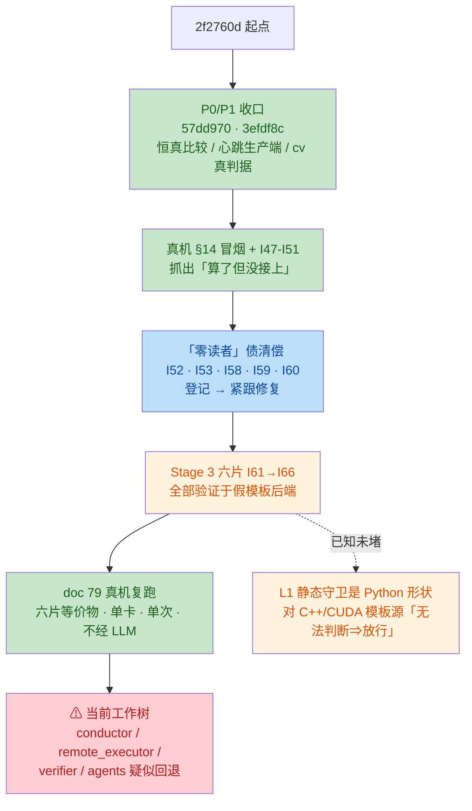

# 批次路线审查：`1c809c7` → `2737843e`（29 个提交）

- **日期**：2026-10-02
- **分支**：`design/autonomous-spine`
- **范围**：`2f2760d`（gitignore）起，经 P0/P1 收口、真机 §14 冒烟、「零读者」债清偿、
  Stage 3 六片（I61–I66），至 `2737843e`（doc 79 真机复跑）止，共 29 个提交
- **性质**：对**提交路线**的审查（顺序、节奏、验证策略），非单点代码审查。
  单提交级的问题见 [doc 79 相关评审]；本篇只回答「这条路走得对不对、哪里偏了」。

---

## 结论摘要

| No. | 级别 | 一句话 |
|---|---|---|
| 1 | **阻断** | 工作树四个核心文件（conductor / remote_executor / verifier / agents）疑似被回退到批次前状态，与 HEAD 及已跟踪测试互相矛盾 —— **当前树上「套件 1934 passed」不可能复现** |
| 2 | 高 | Stage 3 六片全部押在假模板后端上，且这条路径上有一个自己明写的守卫洞（L1 静态守卫是 Python 形状，对 C++/CUDA 模板源「无法判断 ⇒ 放行」） |
| 3 | 中 | 真机验证集中在批尾且单薄（单卡、单次、不经 LLM）；批次内自己落的常驻会话基建（doc 62，单次测量降本 2.4×）没有被路线用上 |
| 4 | 低 | CHECKLOG 索引逆序累积 5 条才修（I62–I66，`dddee79` 才归位） |
| 5 | 中 | doc 79 的三个遗留仍未挂号（复跑脚本在 /tmp＝I29 同型复发；语料核 fp32 反例未拆独立条目；租约两时刻读数无人认领）——恰是本批次花 6 个提交在杀的「算了没人读」模式 |

**总评**：路线的顺序、节奏、测试纪律都是对的；真正的风险不在已走的路上，而在两点 ——
Stage 3 的地基（假后端 + Python 形状守卫洞）和眼前的工作树状态。**先处理 No.1，其余都可以从容排期。**

---

## 一、路线概览与意图推断

这 29 个提交是一条清晰的收口路线：

1. **P0/P1 判据补齐**（`57dd970` 恒真比较 + `3efdf8c` 心跳生产端 + cv 真判据）；
2. **真机 §14 冒烟**抓「算了但没接上」（`f2ba53f` 及 I47–I51）；
3. **「零读者 / 零生产者」债集中清偿**（I52 bandit 信念门、I53 升级门、I54 预算、
   I58 峰值探针、I59 观测租约、I60 逐臂窗口 —— 登记与修复紧跟，不欠账）；
4. **Stage 3 六片**（I61 模板实例化 → I62 参数空间进主循环 → I63 ε-greedy/分相预算 →
   I64 穷尽判据 → I65 静态守卫适用性三态 → I66 stages 轴剪枝），全部验证于**假模板后端**；
5. **doc 79 真机复跑**：六片拿到真机等价物（单卡、单次、不经 LLM，23.6s 全链）。



## 二、路线上做对的地方

1. **优先级正确**：P0（恒真比较、fail-open）最先修，然后才是 P1/P2；「登记 → 紧跟修复」
   的节奏（I52 登记 `3ec7bff` → 修复 `a290783`；I53 登记 → `865a8f9` 修复）没有欠账。
2. **每片都带变异矩阵 + 「明写没做到」边界节**，且把变异矩阵自己的失误（M13 真逃逸、
   M14 假逃逸——观察面缺失）也如实记了 —— 测试纪律在长批次里没有滑坡。
3. **doc 62 常驻会话**把真机测量固定开销从 4.5s 压到 1.87s（重复性差 0.36%，mad/med
   反而更低），这是后面 doc 79 能便宜复跑的基建 —— 批次内的基建投入是划算的。

## 三、问题清单

### No.1（阻断）工作树四个核心文件疑似被回退，与 HEAD 及已跟踪测试矛盾

证据链（五条，全部在**当前工作树**上核实，2026-10-02）：

1. `tests/test_persistent_session.py:29`：
   `from operator_agent.remote_executor import SessionError, _RemoteSession` ——
   而磁盘上的 `operator_agent/remote_executor.py` 里 `SessionError` / `_RemoteSession` /
   `persistent` / `runner_server` **grep 零命中**。该测试在收集阶段即崩。
   （`remote_scripts/runner_server.py` 与该测试文件本身都在、且已跟踪。）
2. `tests/test_template_instantiation.py:34-37`：直接**读 conductor.py 源码**提取
   `_record_stop` 的理由词表并断言含 `template_no_candidate` —— 磁盘版 conductor.py
   的理由只有 passed / stagnant / converged / infra_retry / fix_error / l1_l2_failed /
   search_error，没有 `template_no_candidate`。断言必红。
3. CHECKLOG I62 点名 `conductor.py` 有「轮首取候选 / `action="template"` /
   `bandit_arm` 进血缘」—— 磁盘版 `conductor.py` Step 3（取代码）无任何模板分支，
   `select_template_candidate` / `bandit_arm` / `template_no_candidate` 在
   `operator_agent/` 生产代码里零命中（测试与文档里倒是都有）。
4. doc 79 真机跑出了 `static_guards: True` / `verify_l3_only(static_guards=False)` ——
   磁盘版 `verifier.py` 只有裸的 `verify_l3_only` 签名，无 `static_guards` 参数、
   无 `source_lang` 引用。
5. 按修改时间排序，`conductor.py` / `remote_executor.py` / `verifier.py` / `agents.py`
   恰好是 `operator_agent/` 全目录**最近改动的四个文件** —— 新于批次内任何代码提交
   所写的文件（如 `candidates.py`）。mtime 侧证：这四个文件是在批次之后被**再写入**的。

推断：批次后期（doc 79 前后）某个动作（人 / 工具 / 编辑器恢复）把四个文件写回了旧内容，
且**未提交**。在确认之前，本树上任何测试读数都不可信。

**判别与恢复命令**（按序执行）：

```bash
# ① 判别：未提交回退（预期显示 M 状态）还是提交内回退
cd /Users/zh/repos/operatorAgent
git status --short operator_agent/
git show --stat 2737843e            # 确认最后一个提交是否只动了 docs

# ② 若是未提交回退 → 恢复四个文件到 HEAD
git restore operator_agent/conductor.py operator_agent/remote_executor.py \
            operator_agent/verifier.py operator_agent/agents.py

# ③ 恢复后重跑套件，确认 "1934 passed" 可复现
python -m pytest tests/ -q
```

若 ① 显示这四个文件**干净**（无 M 标记），那问题比回退严重得多 —— 说明批次里
「接进主循环」「常驻会话」的提交内容与 CHECKLOG / 测试声明不符，属于路线级 P0，
需要逐提交 `git show` 核对。

### No.2（高）Stage 3 全押假模板后端，且守卫洞自己明写了却排在后面

- doc 74 §5 承认：实例化 / 剪枝 / 排序只在**假模板后端 + 真 Python 核**（`SLOW_MATMUL`）
  上证过，CUTLASS/TVM 的实例化器与其编译/测量路径**都还没有**。
- 同节第 2 条承认：`anticheat` / `interface_contract` 是 Python 形状的，对 C++/CUDA
  模板源**无法判断 ⇒ 倾向放行**（空转的守卫）。而「模板源真的会被执行」在 I62 之后
  已经是通路上的事实 —— 这条比 I61 时更该尽快补，却排在它后面没有专片。
- 路线把枚举、bandit、预算、穷尽判据都铺好了，唯独「模板源被执行后由谁防作弊」留成
  空转守卫。

**建议**：下一片二选一 —— 真模板后端（CUTLASS/TVM 任一实例化器）或 C++ 形状的 L1
守卫；不要再加搜索侧机制。

### No.3（中）真机验证集中在批尾且单薄；批次内基建没被路线用上

- 约 20 个 mock 验证的提交之后才有一次 23.6s、单卡、单次、不经 LLM 的复跑。
- doc 62 的常驻会话（本批次内落的）已把每次真机测量降本 2.4×（4.5s → 1.87s）——
  Stage 3 的六片完全可以用它做「每两三片一次真机等价物」，路线没有这么做。
- doc 79 的观察①（语料「已知好核」`_TRITON_MATMUL_CODE` 原样在 H20 上过不了 fp32
  的 L2）恰好证明：更早交错真机能更早抓到地基问题。

**建议**：把「真机冒烟」变成 Stage 3 每 N 片的固定动作（常驻会话让单次成本已到秒级）。

### No.4（低）CHECKLOG 索引逆序累积 5 条才修

I62–I66 连续五个提交都把索引行插错位置，直到 `dddee79` 才统一归位 ——「每条登记自带
读数条件」的纪律守住了，但索引顺序这条滑了 5 次。

**建议**：把「索引行按编号升序插入」写进产出 CHECKLOG 条目的固定检查单。

### No.5（中）doc 79 的三个遗留仍未挂号 —— 「算了没人读」的同型复发

| 遗留 | 为什么重要 | 建议归宿 |
|---|---|---|
| 复跑脚本 `/tmp/real_machine_smoke2.py` 未进仓 | I29 立过规矩「出处别指向 /tmp；探针还没进仓库就写清它该长成哪一臂」—— I67 的出处恰好又指向 /tmp，doc 79 的真机读数从此**不可重建** | 收编成 `benchmarks/` 探针（如挂进 `smoke_spine_h20.py` 当新臂），CHECKLOG 出处改指仓内落点 |
| 观察①：语料核 TF32 默认精度过不了 fp32 L2 | 量级被低估：语料「已知好核」在真机上过不了 fp32 L2，直接动摇 KernelDB 种子可用性（RAG 命中它 ⇒ Coder 拿一个必失败的起点）；仓里本有 `verify_corpus_honesty.py` 语料诚实性纪律 | 拆成独立 M 条目；种子核元数据标注精度适用性，或 `_TRITON_MATMUL_CODE` 写明 `input_precision` 的选择理由 |
| 观察②：租约 `external_load=0.0` 与选卡读数是两个时刻 | 产物里没有一格把「测量前快照」与「测量窗内采样」分开 ⇒ 读者可能读成「同一时刻两个说法」 | 产物加时刻格（placement 侧 `DeviceLease` 只记测量窗内，选卡快照未落产物） |

这三个都是本批次花 6 个提交（I47–I52 一族）在杀的「算了没人读」模式 —— 收尾时自己
又造了三个，应当在下一批的第一时间登记。

## 四、总评

路线的顺序（P0 → 冒烟 → 债清偿 → Stage 3 → 真机）、节奏（登记紧跟修复）、测试纪律
（变异矩阵 + 边界节）都是对的，且批次内的基建投入（常驻会话）回报明确。真正的风险
在两点：

1. **眼前的工作树状态**（No.1）—— 先判别、先恢复，之后本树上的读数才重新有意义；
2. **Stage 3 的地基**（No.2）—— 假后端 + Python 形状守卫洞。六片机制铺得越满，
   「模板源被执行却无守卫」这个洞的绝对风险越大，下一片应直奔它，而不是继续加
   搜索侧机制。

---

*审查方法备注：No.1 的证据链由五条独立来源交叉（测试 import、测试读源码断言、
CHECKLOG 出处点名、doc 79 真机输出字段、mtime 排序），并经实时语义索引独立复核
（`SearchCodebase` 零命中）。判别命令见 No.1；本篇写就时工作树尚未恢复。*
