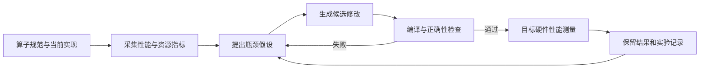

# Agent 助力国产 GPU 算子开发：切入方向与落地路径

整理日期：2026-11-18

本文整理自关于国产 GPU 算子开发的讨论，聚焦 Agent 可以承担的工作、所需基础设施以及首个原型的范围。文中的优先级属于产品落地建议，应结合可获得的硬件、工具链和客户任务调整；不代表本仓库已经实现这些能力。

## 1. 核心思路

最值得入手的是把算子开发中的“分析—修改—编译—验证—测量”变成一个能自动迭代的实验流程。

Agent 的价值不仅在写代码，还在于减少工程师查资料、定位问题、反复试验和整理结果的时间。最终效果需要由独立测试和目标硬件实测确认。

## 2. 六个切入方向

| 方向 | Agent 具体做什么 | 主要价值 | 建议优先级 |
|---|---|---|---|
| 测试与错误定位 | 生成测试、复现错误、缩小失败输入、分析编译和运行日志 | 降低调试成本，建立可信反馈 | 最先做 |
| 已有算子迁移 | 理解原实现，检索目标平台接口，修改并反复验证 | 帮助客户模型在国产硬件上运行 | 高 |
| 性能诊断 | 读取 profiler、代码和输入特征，提出可验证的瓶颈假设 | 缩短专家分析时间 | 高 |
| 局部优化与自动调优 | 修改分块、布局、流水线、融合方案并实测 | 提高算子性能 | 高，但依赖测量基础 |
| 模型级算子优化 | 找到关键路径、选择融合边界、验证整模型收益 | 将单算子收益转化为业务收益 | 第二阶段 |
| 回归与经验积累 | 定位性能退化，保存成功与失败实验，生成补丁和报告 | 降低长期维护成本 | 应贯穿全程 |

## 3. 测试、复现和修复 Agent

### 3.1 典型问题

算子开发中，大量时间花在“为什么这个输入不对”上，例如：

- 规则尺寸正确，尾部不对齐时越界。
- 小输入正确，大输入出现精度问题。
- 单次执行正确，多流并发时偶发错误。
- 编译通过，但某个布局触发错误的数据读取。

### 3.2 自动化流程

1. 读取算子定义、参考实现和支持范围。
2. 生成形状、精度、布局、数值分布的测试组合。
3. 编译并在目标设备执行。
4. 将失败案例缩小成可复现的最小输入。
5. 根据日志和代码提出修复，重新验证。

### 3.3 验证边界

参考实现、允许误差和最终验收规则由独立的测试系统控制。Agent 可以扩充测试，但不能通过放宽误差、删除失败用例来让自己的代码通过。

针对越界、未初始化内存和同步问题，应接入目标平台提供的检测工具。例如 NVIDIA 的 Compute Sanitizer 提供相应检查；国产平台需要适配自身可用的能力，缺少工具时应明确验证边界。参见 [Compute Sanitizer 官方文档](https://docs.nvidia.com/compute-sanitizer/ComputeSanitizer/)。

这一方向的价值在于：即使 Agent 暂时写不出顶尖内核，也能交付工程师每天会用到的结果。

## 4. 算子迁移 Agent

输入可以是一个 CUDA、Triton 或其他平台的算子，输出是目标硬件上的可运行实现和验证结果。

迁移需要同时处理两个问题：

- **语义迁移**：运算、布局、同步和精度行为是否保持正确。
- **性能迁移**：原来的并行方式、分块和数据搬运策略是否适合目标芯片。

建议先得到正确版本，再优化性能，以便判断每次修改解决了什么问题。

### 4.1 目标平台知识

| 知识内容 | 用途 |
|---|---|
| 编程接口、编译选项和版本限制 | 避免使用不存在或不兼容的 API |
| 矩阵指令、存储层次、同步机制 | 决定算法如何映射到硬件 |
| 已验证的示例和高性能算子 | 提供可靠的实现模式 |
| 常见报错及解决案例 | 加快修复 |
| 形状与性能记录 | 判断某种实现适合什么输入 |

这些知识应具有明确版本，并连接厂商文档、代码和真实编译器，不能只依赖模型记忆。对于资料较少、工具链变化快的平台，检索与实测尤其重要。

## 5. 性能优化 Agent

### 5.1 每次修改都有假设和证据

一个有用的优化 Agent 应当能够提出可验证的实验计划，例如：

> 当前内核存在较多寄存器溢出，可能增加了额外访存。尝试缩小分块，观察溢出是否下降，以及执行时间是否改善。

### 5.2 搜索空间

- **实现策略**：是否融合、如何分块、怎样组织归约、是否使用异步流水线。
- **具体参数**：分块尺寸、并行度、流水线级数等。

两类搜索可以结合：Agent 负责提出策略和缩小范围，成熟的自动调优算法负责大量参数试验，以控制模型调用成本和 GPU 实验成本。

已有工作可参考 PyTorch 的 KernelAgent：它将性能分析、瓶颈诊断、候选优化和实测组成反馈流程。其公开结果对应特定硬件和测试任务，迁移到国产平台后仍需重新验证。参见 [KernelAgent 技术介绍](https://pytorch.org/blog/kernelagent-hardware-guided-gpu-kernel-optimization-via-multi-agent-orchestration/) 和 [代码仓库](https://github.com/meta-pytorch/KernelAgent)。

## 6. 核心基础设施：可信的算子实验执行器

实验执行器决定 Agent 收到的反馈是否可靠，应作为产品的优先投入。

### 6.1 最小工具接口

以下为建议的逻辑接口，不表示仓库中已有同名实现。

| 接口 | 返回内容 |
|---|---|
| `compile` | 编译结果、报错、可获得的资源占用信息 |
| `check_correctness` | 失败输入、误差统计、边界问题 |
| `benchmark` | 延迟分布、基线比较、测量条件 |
| `profile` | 可获得的访存、计算、等待及资源指标 |
| `run_model_slice` | 算子放回模型片段后的收益 |
| `record_experiment` | 代码、环境、输入、结果和优化假设 |

### 6.2 测量与执行要求

- GPU 执行通常是异步的，计时必须正确同步。
- 编译时间、预热时间和稳定执行时间分别记录。
- 基线与候选在可比的设备状态下重复测量。
- 多个候选可以并行生成，但共享同一设备的性能测试应避免互相干扰。
- 测量包含任务约定的转换、拷贝和临时内存开销。
- 每次实验绑定代码、编译器、驱动和硬件版本。
- 设置实验预算、超时和停止条件，保留已验证的最好版本。

如果测量有偏差，Agent 会持续优化那个偏差。因此，这层基础设施的重要性至少与代码生成能力相当。

## 7. 第一个原型的建议范围

### 7.1 目标

针对一种国产芯片，优化一个已有正确实现的算子，自动完成测试、诊断、有限轮次优化和结果交付。

可以从真实模型中的 RMSNorm、Softmax、残差加归一化等任务中选择，前提是性能分析确认它值得优化。这些任务通常比完整注意力或复杂 MoE 内核更容易建立正确性和性能反馈。

### 7.2 原型边界

| 项目 | 限定范围 |
|---|---|
| 硬件 | 一个具体型号和固定工具链 |
| 任务 | 一个算子或短融合片段 |
| 输入 | 参考实现、现有内核、真实输入分布、误差要求 |
| Agent 能做的修改 | 内核代码、明确允许的调优参数 |
| 独立控制的部分 | 参考结果、验收规则、最终测试集、性能执行器 |
| 输出 | 可复现补丁、测试报告、逐输入性能、资源变化和适用范围 |

### 7.3 验收指标

- 工程师节省了多少时间。
- 在固定预算内，多少任务产生了正确且有收益的结果。
- 真实输入分布下的整体收益和最差退化。
- 每个可接受优化消耗多少 GPU 时间和模型调用成本。
- 放回模型片段后，收益是否仍然存在。

可以借鉴 KernelBench 同时衡量“正确”和“超过性能基线”的思路，但内部验收应加入客户真实输入及未参与搜索的测试案例。参见 [KernelBench 论文](https://arxiv.org/abs/2502.10517)。

## 8. 多 Agent 的引入时机

初期一个 Agent 加稳定的工具流程就能验证价值。等实验执行器和评价标准成熟后，多 Agent 适合用于探索不同假设，例如：

- 减少显存访问。
- 降低寄存器占用。
- 改变并行划分。
- 调整融合边界。

不同角色应使用独立候选代码，并由统一执行器测量。最终是否接受优化，依据测试结果和实测收益；多个 Agent 给出一致意见，也不能替代验证。

## 9. 推荐落地路径

首先构建“已有算子的诊断、修复和优化助手”，配套可靠的目标硬件执行器。

这一切入点有明确输入和可验证输出，也能逐步积累平台知识、失败案例和性能数据，为后续自动迁移、复杂融合与模型级优化打基础。

建议按以下顺序推进：

1. 建立固定硬件上的正确性与性能执行器。
2. 接入已有算子的测试、复现和修复流程。
3. 增加基于实测指标的局部优化循环。
4. 验证模型片段收益，沉淀可复现实验记录。
5. 扩展到算子迁移、更多任务类型及多策略搜索。
